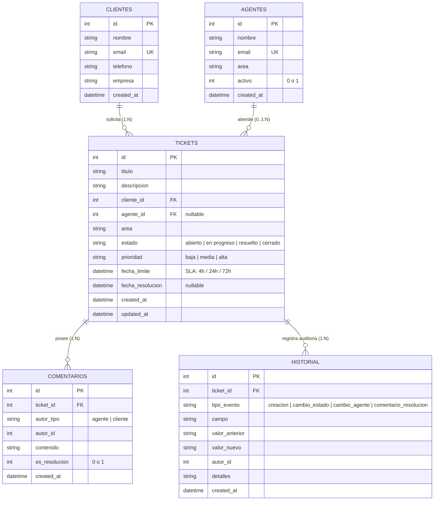

# Diseño de Base de Datos Relacional - Mesa de Ayuda

## Motor Seleccionado
- **Motor:** SQLite (vía `node:sqlite` nativo en Node.js 24 / compatible con `better-sqlite3`).
- **Archivo:** `backend/database/mesa.db`.
- **Integridad:** Claves foráneas habilitadas (`PRAGMA foreign_keys = ON;`).

## Diagrama Entidad-Relación (ERD)



## Reglas de Integridad y Restricciones (DDL)

1. **Estados del Ticket (`estado`):**
   `CHECK (estado IN ('abierto', 'en progreso', 'resuelto', 'cerrado'))`
2. **Prioridades del Ticket (`prioridad`):**
   `CHECK (prioridad IN ('baja', 'media', 'alta'))`
3. **Plazos de SLA en `fecha_limite`:**
   - Alta: 4 horas (`created_at + 4 hours`)
   - Media: 24 horas (`created_at + 24 hours`)
   - Baja: 72 horas (`created_at + 72 hours`)
4. **Comentarios de Resolución (`es_resolucion`):**
   `CHECK (es_resolucion IN (0, 1))`
5. **Políticas de Integridad Referencial y Borrado:**
   - `ON DELETE RESTRICT` en `cliente_id`: Impide eliminar un cliente si tiene tickets asociados (evita orfandad y pérdida de datos).
   - `ON DELETE RESTRICT` en `agente_id`: Impide eliminar un agente si tiene tickets asignados o históricos. Para desincorporar agentes se utiliza borrado lógico (`activo = 0`), preservando la trazabilidad de quién atendió cada ticket.
   - `ON DELETE RESTRICT` en `comentarios(ticket_id)` e `historial(ticket_id)`: Protege la inmutabilidad de la auditoría. Impide borrar físicamente un ticket que posea comentarios o historial auditable.

## Procedimiento de Inicialización y Comprobación

### 1. Inicialización de Esquema y Datos de Prueba
Desde la carpeta `backend/`:
```bash
npm run db:init
```
Este comando ejecuta:
- Borrado previo del archivo `.db` para asegurar reproducibilidad.
- Creación de tablas e índices desde `database/schema.sql`.
- Inserción de semillas desde `database/seeds.sql`.
- Validación de integridad referencial (`PRAGMA foreign_key_check`).

### 2. Ejecución de Suite de Verificación
Desde la carpeta `backend/`:
```bash
npm run db:verify
```
Valida de forma automatizada:
1. Rechazo de estados no permitidos (`CHECK constraint failed`).
2. Rechazo de prioridades no permitidas (`CHECK constraint failed`).
3. Rechazo de claves foráneas inexistentes (`FOREIGN KEY constraint failed`).
4. Consulta SQL de asignación automática de agente con menor carga por área.
5. Consulta SQL de métricas agregadas para `GET /api/resumen`.
6. Comportamiento transaccional (`ROLLBACK` automático ante excepciones).
